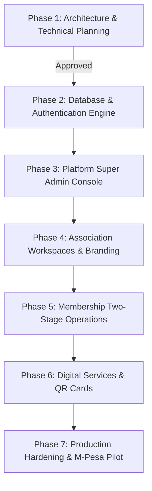

# RiderHub 360 — Development Roadmap

This roadmap defines the implementation phases from architecture planning through pilot testing and production readiness.

---

## Roadmap Phases

### Phase 1: Architecture & Technical Planning (Current Status: ✅ Completed)
- Complete System Architecture (`ARCHITECTURE.md`).
- PostgreSQL Relational Schema (`DATABASE_SCHEMA.md`).
- Entity Relationship Diagrams (`ERD.md`).
- Role-Based Access Control Matrix (`ROLE_PERMISSION_MATRIX.md`).
- Row Level Security Policies (`RLS_POLICIES.md`).
- Security & Threat Assessment (`SECURITY.md`).
- Paid SaaS Subscription Design (`SUBSCRIPTION_ARCHITECTURE.md`).
- Complete API Route Catalog (`API_DOCUMENTATION.md`).
- Application Directory Mapping (`PROJECT_STRUCTURE.md`).

### Phase 2: Database & Authentication Engine (Current Status: ✅ Completed)
- Multi-tenant Drizzle schema (`src/db/rh-schema.ts`).
- Embedded PostgreSQL PGlite snapshot loader with persistent `.data/pgdata.tar`.
- Scrypt password hashing & session management (`src/lib/password.ts`, `src/lib/authz.ts`).
- Super Admin login bypass & role recovery (`kuriajoe85@gmail.com`).

### Phase 3: Platform Super Admin Console (Current Status: ✅ Completed)
- Platform console layout (`/platform`).
- Tenant onboarding, plan assignment, and subscription management.
- Manual payment review and activation.
- Embedded Welfare Contribution System under the "Welfare System" tab.

### Phase 4: Association Workspaces & Dynamic Branding (Current Status: ✅ Completed)
- Multi-tenant workspace routing (`/w/[slug]`).
- Dynamic theme application (primary, secondary, and accent colors from database).
- Station creation, code assignment, and single active Chairperson appointment.
- Station-specific registration token generator (`/join/[token]`).

### Phase 5: Membership Operations & Custom Form Builder (Current Status: ✅ Completed)
- Configurable field builder (`member_custom_field_definitions`).
- Public registration intake with custom fields.
- **Stage 1:** Chairperson review, bike verification, and recommendation note.
- **Stage 2:** Association Owner/Admin final approval, sequential membership number generation, and audit logging.
- Inter-station rider transfers preserving historical identity.

### Phase 6: Digital Services & Reporting (Current Status: ✅ Completed)
- Digital membership card rendering with dynamic branding and member photos.
- Secure public QR code verification screen (`/verify/[id]`).
- Station and association member registers with CSV and printable exports.

### Phase 7: Production Hardening & M-Pesa Pilot (Next Step)
- Live pilot deployment with **ROCS CREW** (Exit 5 & TRM stages) and **Githurai Kimwi Association** (Kimwi Stage).
- Automated M-Pesa Daraja C2B webhook listener for subscription collection.
- End-to-end pen-testing across tenant boundaries.
