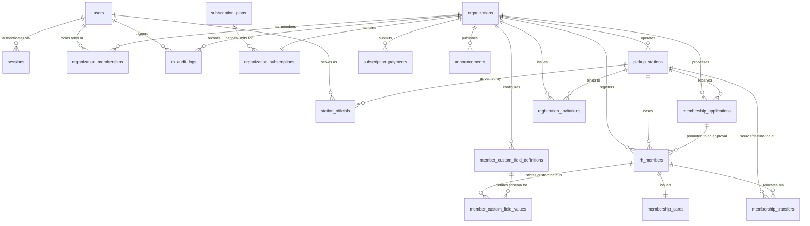
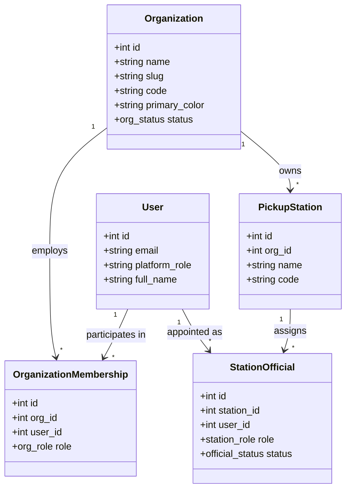
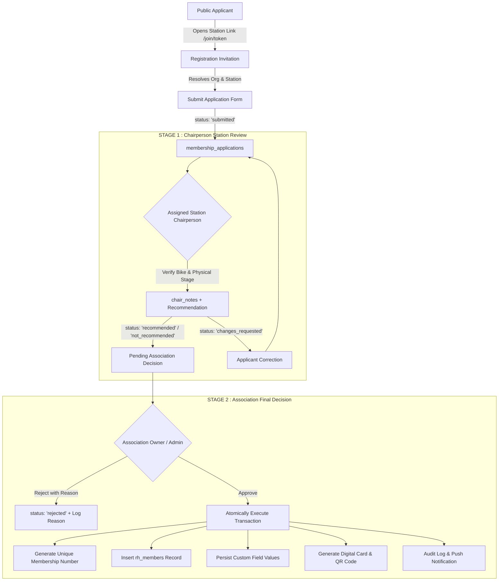
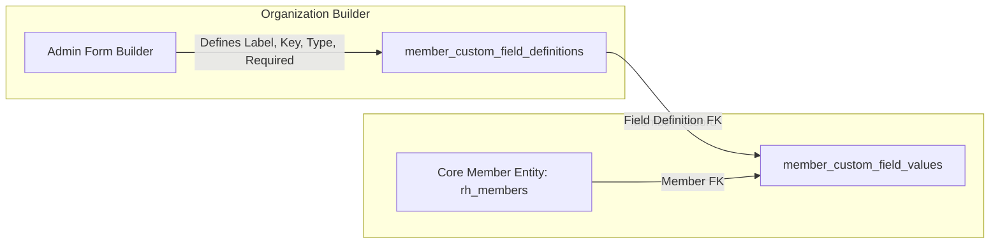

# RiderHub 360 — Entity Relationship Diagram (ERD)

This document diagrams the complete relational model of RiderHub 360, demonstrating tenant boundaries, station hierarchy, two-stage approvals, dynamic custom fields, and monetization.

---

## 1. Master Entity Relationship Diagram

---

## 2. Structural Subsystem Relationships

### 2.1 Multi-Tenant Governance & Station Leadership

### 2.2 Two-Stage Membership Approval Engine

### 2.3 Dynamic Custom Field Schema

