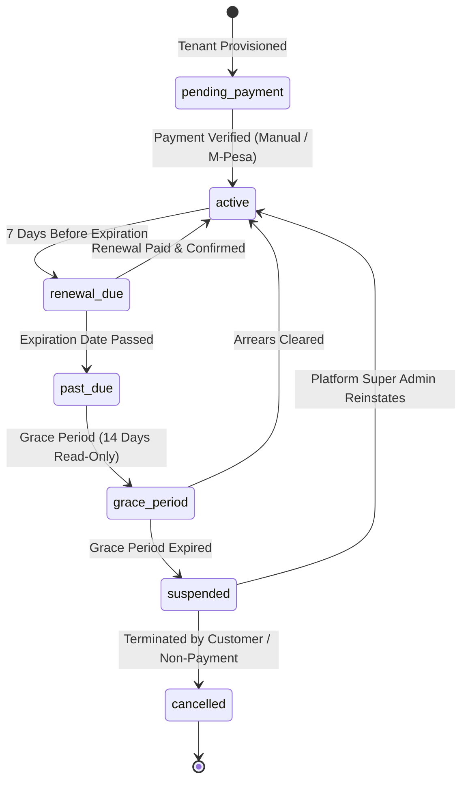

# RiderHub 360 — Paid SaaS Subscription Architecture

RiderHub 360 is monetized via paid subscriptions from Day 1. There is no unrestricted free plan. This document details the subscription tiers, lifecycle states, entitlement enforcement, and payment verification flow.

---

## 1. Subscription Tiers & Quota Limits

All plans and pricing are configurable in the database (`subscription_plans`) and managed by the Platform Super Admin:

| Plan Code | Display Name | Monthly Price | Annual Price | Max Stations | Max Members | Max Admins | Storage Cap | Target Customer |
| :--- | :--- | :---: | :---: | :---: | :---: | :---: | :---: | :--- |
| `starter` | **Starter** | KES 1,500 | KES 15,000 | 3 | 100 | 2 | 100 MB | Small community stages |
| `growth` | **Growth** | KES 3,500 | KES 35,000 | 10 | 500 | 5 | 500 MB | Expanding multi-stage associations |
| `professional` | **Professional**| KES 7,500 | KES 75,000 | 25 | 2,000 | 10 | 2,048 MB | Sub-county wide associations |
| `enterprise` | **Enterprise** | KES 15,000| KES 150,000| 200 | 20,000 | 50 | 10,240 MB | County / National Federations |

---

## 2. Subscription Lifecycle State Machine



### State Behavior Matrix:
- `active`: Full platform access, registrations open, member cards generated.
- `renewal_due`: Banner shown to association officials alerting them to upcoming renewal. All operations continue uninterrupted.
- `past_due` / `grace_period`: System enters **Strict Read-Only mode**. Existing records remain visible; new member registrations and card issuances are paused.
- `suspended`: Association workspace access is locked (`403 Payment Required`). A suspension modal informs officials to contact Platform Billing.
- `cancelled`: Account archived; data retained for statutory compliance.

---

## 3. Server-Side Entitlement & Capacity Checks

Before any resource creation, the backend validates both **Subscription Status** and **Resource Capacity**:

```typescript
// Verified in src/lib/authz.ts
export async function assertEntitled(orgId: number): Promise<void> {
  const sub = await getSubscription(orgId);
  const activeStatuses = ["active", "renewal_due"];
  if (!sub || !activeStatuses.includes(sub.status)) {
    throw new HttpError(402, `Workspace access requires an active subscription (Current status: ${sub?.status ?? 'none'}).`);
  }
}

export async function assertCapacity(orgId: number, resource: "stations" | "members" | "admins"): Promise<void> {
  const sub = await getSubscription(orgId);
  const plan = sub.plan;
  const currentCount = await countResource(orgId, resource);
  
  if (currentCount >= plan[`max_${resource}`]) {
    throw new HttpError(403, `Plan limit exceeded: Your ${plan.name} plan supports up to ${plan[`max_${resource}`]} ${resource}. Please upgrade your subscription.`);
  }
}
```

---

## 4. Payment Verification & M-Pesa Integration Strategy

1. **Phase 1 (Manual Super Admin Verification):**
   - Association submits transaction details (Bank slip or M-Pesa transaction code).
   - Platform Super Admin reviews the payment inside the Platform Console (`/platform`).
   - Super Admin clicks "Verify & Activate", updating `subscription_payments.status = 'verified'` and extending `organization_subscriptions.current_period_end`.
2. **Phase 2 (Automated M-Pesa Daraja C2B/B2C):**
   - M-Pesa webhook calls `POST /api/webhooks/rocpay`.
   - Payload is validated with M-Pesa secret signature.
   - Account reference matches `SUB-<org_slug>`.
   - Subscription is automatically transitioned to `active` with audit record.
